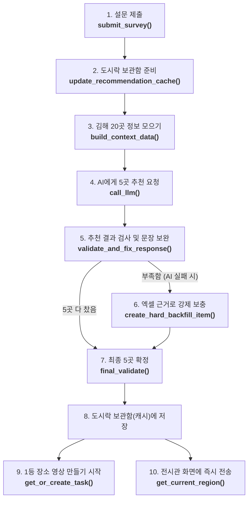

이 문서는 `app.py`, `mock_video.py`, `devlog.py`, `run_flow.py`를 설명합니다.

---

## 0. 프로그램 전체 실행 흐름도 (함수 이름별 쉬운 설명)

손님이 태블릿에서 질문을 누르고 결과를 보기까지, **어떤 함수들이 무슨 일(역할)을 하는지** 식당 주방에 빗대어 쉽게 그린 지도입니다.

### 함수 이름과 쉬운 역할 총정리 (순서대로)
1. **`submit_survey()` (카운터)**: 손님이 고른 4개 답을 받아서 `"조용히 산책하기 좋은 역사 명소"`처럼 한 문장으로 예쁘게 엮습니다.
2. **`update_recommendation_cache()` (보관함 관리인)**: 주방(`run_recommendation_pipeline`)에 요리를 시키고, 다 만들어진 5곳을 메모리 도시락 통에 잘 넣어둡니다.
3. **`run_recommendation_pipeline()` (주방장 총괄)**: 5곳을 어떻게든 완벽하게 만들어내는 사령탑입니다.
   - **`build_context_data()`**: 김해 20곳 관광지 설명서를 책에서 찾아 AI에게 건넬 종이로 만듭니다.
   - **`call_llm()`**: AI에게 종이를 주면서 "여기서 손님 취향에 맞는 곳 추천해줘" 하고 부탁합니다.
   - **`validate_and_fix_response()` & `_build_validated_item()`**: AI가 거짓말을 했거나 엉뚱한 장소를 말했는지 검사관처럼 꼼꼼히 살핍니다. 문장이 너무 짧으면 **`get_grounded_filler()`**가 진짜 책(CSV) 내용을 살짝 덧붙여서 2문장 이상으로 늘려줍니다.
   - **`rank_places_by_preference()` & `create_hard_backfill_item()` (비상 레토르트)**: AI가 3곳만 말하고 입을 닫아버려도 당황하지 않고, 손님 취향 단어가 적힌 장소를 엑셀에서 직접 복사해 와서 5곳을 무조건 채웁니다.
   - **`final_validate()`**: 손님 상에 나가기 직전에 5곳 목록을 한 번 더 검사합니다.
4. **`get_or_create_task()` (영상 접수처)**: 1등 장소에 대해 "영상 제작 번호표"를 뽑아줍니다.
5. **`video_status()` (영상 진행 전광판)**: 태블릿이 "지금 몇 퍼센트 됐어요?" 물어보면 경과 시간에 맞춰 진행 상황(배경 제작 중 ➡️ 합성 중 ➡️ 완성)을 알려줍니다.
6. **`get_current_region()` (전시관 전광판)**: 전시관 메인 서버가 "지금 관람객 결과 줘!" 하고 요청할 때, 아까 넣어둔 도시락을 **0.005초(빛의 속도)만에 툭** 꺼내줍니다. 오래 걸리는 AI를 다시 부르지 않습니다.

---

## 1. `app.py` — 메인 서버 (식당 주방)

### 1-1. 기본 준비 (1~122행)
- **CORS 허용**: 다른 웹사이트(전시 화면)도 우리 서버에 말을 걸 수 있게 "출입문을 열어두는" 설정입니다.
- **로그 기록 장치**: 누가 어떤 요청을 했고 얼마나 걸렸는지 한글로 기록합니다. (CCTV 같은 역할)
- **상수(설정값)**: "추천은 5곳", "AI에게 최대 3번 물어봄", "추천 이유는 2~5문장" 같은 약속을 숫자로 적어둔 곳입니다.
- **CSV 읽기**: 엑셀 같은 파일(`여행지_20_김해_수정본.csv`)에서 관광지 20곳의 정보를 메모리에 올립니다. 이게 **우리가 가진 유일한 정답지**입니다.

### 1-2. 글자 다듬는 도구들 (124~244행)
AI가 쓴 글은 가끔 형식이 어긋납니다. 이를 고치는 "교정 도구 상자"입니다.

| 함수 | 쉬운 설명 |
|---|---|
| `clean_text` | 빈칸, "nan"(값 없음) 같은 쓰레기를 지워 깨끗한 글자로 만듭니다. |
| `split_sentences` | 글을 `.` `!` `?` 기준으로 문장 단위로 쪼개 셉니다. 5글자 이하 조각은 문장으로 안 칩니다. |
| `fix_missing_internal_punctuation` | AI가 "~입니다 수로왕릉은~" 처럼 마침표를 빼먹으면 "~입니다. 수로왕릉은~" 으로 고쳐줍니다. |
| `limit_to_five_sentences` | 너무 길면 5문장까지만 남기고 자릅니다. |
| `default_image_prompt` | AI가 이미지 설명을 안 줬을 때 기본 문구를 넣습니다. |
| `theme_as_tag_candidate` | 테마가 짧은 단어일 때만 "태그(#키워드)"로 씁니다. 긴 문장은 태그로 부적절해서 버립니다. |

### 1-3. 근거 보충과 "비상 대책" (246~369행)
AI가 쓴 추천 이유가 너무 짧으면 어떻게 할까요?

- **`get_evidence_candidates`**: 한 장소에 대해 CSV에 적힌 근거 문장들을 중요한 순서대로 모읍니다.
- **`get_grounded_filler`**: 추천 이유가 2문장 미만이면 CSV의 **실제 근거 문장**으로 채웁니다. 없는 말을 지어내지 않는 것이 핵심입니다.
- **`create_hard_backfill_item` (하드 백필)**: AI가 아예 고장 났을 때의 **최후의 비상 대책**입니다. AI 없이 CSV 문장만 이어 붙여 추천 항목을 만듭니다. 품질은 낮아도 "서버가 멈추지 않는 것"이 목적입니다.
- **`rank_places_by_preference`**: 비상 대책을 쓸 때 항상 1번 장소부터 채우면 불공평하니, 손님 취향 문장과 **겹치는 단어가 많은 장소**를 먼저 고릅니다. (단순하지만 없는 것보다 낫습니다.)

### 1-4. AI 답변 읽기와 검사 (371~514행)
- **`extract_json_array`**: AI는 답변 앞뒤에 "알겠습니다!" 같은 군더더기를 붙이곤 합니다. 거기서 **실제 목록 부분만 오려냅니다.**
- **`_build_validated_item` (검사관)**: 추천 1건마다 아래를 확인합니다.
  1. 장소 번호가 CSV에 실제로 있는가? 이미 뽑힌 장소는 아닌가?
  2. 추천 이유가 2~5문장인가? (모자라면 근거로 보충)
  3. 태그가 2~3개인가? (모자라면 "김해여행" 같은 기본 태그로 채움)
  4. 장소 이름은 AI가 쓴 걸 믿지 않고 **CSV의 정확한 이름**으로 덮어씁니다.
- **`validate_and_fix_response`**: AI가 준 목록 전체를 검사관에게 차례로 통과시킵니다.
- **`final_validate`**: 모두 모은 뒤 **마지막으로 한 번 더** 검사합니다. (출고 전 최종 검수)

### 1-5. AI에게 질문하기 (516~686행)
- **`build_context_data`**: AI에게 줄 "참고 자료집"을 만듭니다. 이미 추천한 장소는 뺍니다.
- **`build_system_instruction`**: AI에게 주는 **업무 지침서**입니다. "데이터에 없는 건 지어내지 마라", "이유는 2~5문장", "JSON 배열로만 답해라" 등이 적혀 있습니다.
- **`call_llm`**: 실제로 AI(지금은 내 컴퓨터의 Ollama)에게 질문을 보내고 답을 받습니다.
- **(주석 처리된 OpenAI 버전)**: 현장에서는 OpenAI로 바꿀 예정이라, 바꾸는 방법과 코드를 설명과 함께 주석으로 준비해 두었습니다.

### 1-6. 추천 파이프라인 — 핵심 두뇌 (`run_recommendation_pipeline`, 688~775행)
3단계 안전망으로 되어 있습니다.

1. **1단계 – AI에게 묻기**: 5곳이 모일 때까지 최대 3번 물어봅니다. 모자라면 "나머지 N곳만 더"라고 다시 묻습니다. AI가 고장 나도 에러를 삼키고 다음 단계로 넘어갑니다.
2. **2단계 – 하드 백필**: 그래도 5곳이 안 되면 CSV 근거로 직접 채웁니다.
3. **3단계 – 최종 검수**: 5곳이 안 되면 그때 비로소 오류를 냅니다.

> 비유: "1순위 요리사에게 부탁 → 안 되면 레토르트로 보충 → 마지막에 접시 검수"

### 1-7. 취향 저장과 캐시 (778~827행)
- **캐시(cache)** = **"미리 만들어 둔 도시락"**. AI가 답을 만드는 데 수십 초가 걸리니, 한 번 만든 결과를 메모리에 보관해 두고 다음에 요청이 오면 바로 꺼내줍니다.
- `latest_preference`: 가장 최근 손님의 취향 문장.
- `update_recommendation_cache`: 추천을 새로 만들어 도시락 보관함에 넣습니다. 전시 시스템이 필요한 3가지 항목(이름, 번호, 이유)만 남깁니다.
- `POST /preference`: 취향을 등록하면서 바로 도시락을 새로 만듭니다.

### 1-8. `GET /current_region` — 전시 시스템이 부르는 창구 (829~872행)
- 전시 서버가 "김해 추천 알려줘"라고 물으면:
  - 지역이 `GIMHAE`가 아니면 → "찾을 수 없음" 메시지
  - 도시락이 있으면 → **즉시 반환**(약 5ms)
  - 도시락이 없으면 → 새로 만들어서 반환
  - 만들다 실패하면 → 이전 도시락이 있으면 그걸로 대신 반환
- 대회 규격에서 정한 응답 모양을 그대로 지킵니다.

### 1-9. 설문과 영상 (874~959행)
- **설문 4문항**: 각 선택지에 "문장 조각"이 붙어 있습니다. 예) "고요하게 쉬는 힐링 여행" → "조용히 걸으며 힐링할 수 있는"
- **`POST /api/survey`**: 4개 답을 받아 조각을 이어 **하나의 취향 문장**을 만들고 → 추천을 만들고 → 1순위 장소의 영상 제작을 **미리 시작**합니다. 손님이 추천 카드를 읽는 동안 영상이 만들어지는 "시간 벌기" 장치입니다.
- **`GET /api/survey/questions`**: 태블릿 화면이 질문과 선택지를 그릴 수 있게 문항 목록을 내려줍니다. (문장 조각은 내부용이라 내려주지 않습니다.)
- **입력 검사**: 답이 4개가 아니거나 0·1이 아니면 거절합니다.
- **스레드풀(`run_in_threadpool`)**: 주방에서 오래 걸리는 요리를 **별도 직원에게 맡기는 것**입니다. 이렇게 안 하면 요리 하나 하는 동안 다른 주문을 못 받습니다.
- `GET /api/dev-log`: 개발자가 진행 상황을 화면에서 볼 수 있게 로그를 내려줍니다.
- 마지막 줄들은 서버를 **5000번 문**으로 열고(대회 규격), 화면 파일(`static/`)을 함께 제공합니다.

---

## 2. `mock_video.py` — 가짜 영상 제작소

실제 영상 AI(ComfyUI)는 아직 없어서, **시간이 흐르면 진행 단계가 바뀌는 것처럼 흉내**만 냅니다.

- 작업 요청이 오면 접수 번호(`task_id`)를 발급합니다. 같은 손님·같은 장소는 **기존 번호를 재사용**합니다.
- 상태 조회가 올 때마다 **경과 시간**으로 단계를 판단합니다.

| 경과 시간 | 단계 |
|---|---|
| 0~2초 | 입력 확인 |
| 2~5초 | 배경 이미지 생성 |
| 5~8초 | 영상 변환 |
| 8~10초 | 결과 저장 |
| 10초 이후 | 완료 → 샘플 영상(`sample.mp4`) 전달 |

> 비유: "배달 앱의 진행 상황 표시"를 시간표로 흉내 낸 것.

---

## 3. `devlog.py` — 일기장

`dev_log("메시지")`를 부르면 **시각과 함께 터미널에 출력**하고 **메모리 목록에도 저장**합니다. 개발 화면이 이 목록을 읽어 진행 상황을 보여줍니다. (12줄짜리 간단한 파일)

---

## 4. `run_flow.py` — 진행 상황 중계 (개발 전용)

서버가 켜져 있는 상태에서 **손님처럼 실제로 요청을 보내 보며**, 무슨 일이 일어나는지 화면에 중계해 주는 도구입니다.

- 어떤 API를 불렀는지 (`→ 요청` / `← 응답 코드와 걸린 시간`)
- 서버가 안에서 거친 단계 (서버의 일기장 `devlog`를 가져와 `[서버 시각]`으로 표시)
- AI가 답하는 동안의 경과 시간, 영상 제작의 진행 막대 (`[#####-----] 3/5`)

4단계로 진행합니다: ① 설문 문항 조회 → ② 설문 제출과 추천 생성 → ③ 영상 진행도 확인 → ④ 전시 연계 API(`/current_region`) 조회.

> 서버 코드를 가져다 쓰지 않고, 서버와는 **HTTP로만** 이야기합니다. 서버를 먼저 켜야 하고, 꺼져 있으면 안내 메시지를 띄웁니다.

사용법: `python run_flow.py` 또는 `python run_flow.py 1,0,1,1` (설문 선택지 지정)

---

## 5. 코드 리뷰 요약

### 잘 된 점
- AI가 틀려도 서버가 멈추지 않는 **3단계 안전망**
- AI의 말을 믿지 않고 **CSV 정답지로 이름·번호를 검증**
- 한 번 만든 결과를 보관하는 **캐시**로 전시 시스템에 빠른 응답
- 대회 규격(필드, CORS, 5000 포트)을 충실히 준수

### 이번에 고친 것
- 오래 걸리는 AI 호출이 **서버 전체를 멈추지 않도록** 개선 (`/preference`, `/current_region`)
- 설문 입력 검사 강화, 추천 실패 시 친절한 오류(503) 반환
- 깨진 주석 수정, OpenAI 전환 코드를 **주석으로 준비**

### 앞으로 고려할 점
| 항목 | 설명 |
|---|---|
| 동시 접속 | 여러 손님이 동시에 설문하면 "최신 취향/도시락"이 서로 덮어씁니다. 단일 키오스크면 괜찮습니다. |
| 로그/작업 목록 | 계속 쌓이기만 해서 오래 켜두면 메모리가 늘어납니다. |
| 첫 호출 지연 | 도시락이 비어 있을 때 첫 `/current_region`은 AI 응답을 기다립니다. |
| 패키지 버전 | `requirements.txt`가 버전을 고정하지 않아 현장 재현성이 떨어집니다. |

